# Chord Code: conceito visual

Referência visual oficial do **Chord Code Pro** (1.2.2; o Mini 1.1.0 usa o mesmo tema) para usar em outros projetos: anúncios, landing pages, vídeos, novos plugins da família.

- Atualizado em **20/11/2026**. As cores e medidas do plugin foram conferidas no código ([`Source/ChordCodeTheme.h`](../../Source/ChordCodeTheme.h), o mesmo tema do Pro).
- Todas as imagens citadas estão em [`img/`](img/). A fonte HTML do story mais recente está em [`fonte/`](fonte/).

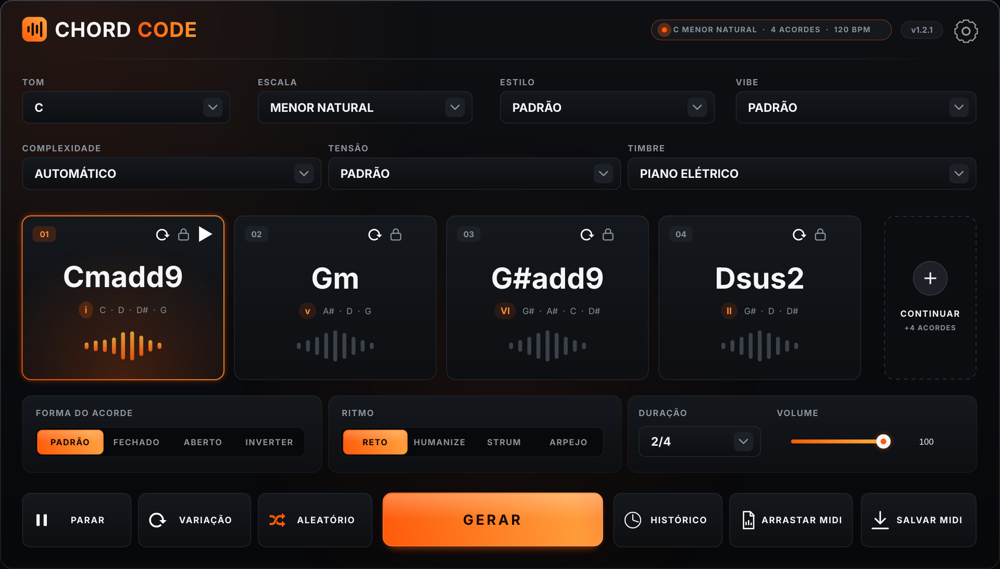

## Sumário
1. Conceito e posicionamento
2. Identidade visual (clima, paleta, tipografia, formas, logo)
3. A interface, peça por peça
4. Telas secundárias
5. Movimento e microinterações
6. Peças de marketing e moldes
7. Textos e frases prontas

## Resumo em 30 segundos
| | |
|---|---|
| Clima | Dark premium com calor laranja. Fundo quase preto, laranja usado como **luz** (glow), nunca neon nem cor fria |
| Cor única de acento | Laranja `#FF5A0A` → âmbar `#FFB23D` (gradiente) |
| Fundo | `#07080A` (plugin) · `#050606` (landing/anúncios) |
| Texto | `#F5F6F8` principal · `#8B929C` secundário |
| Fontes | Inter (plugin, rótulos em caixa alta espaçada) · Space Grotesk (títulos de marketing) · Manrope (texto da landing) |
| Wordmark | CHORD branco + CODE laranja, Bold, caixa alta |
| Elemento-assinatura | Card de acorde: nome enorme, pílula de grau laranja, notas com pontos, 9 barras de waveform |
| Títulos | Duas batidas: 1ª parte branca, 2ª laranja ("Você traz a ideia. **Ele encontra os acordes.**") |

---

## 1. Conceito e posicionamento

### O problema
O produtor tem uma ideia (um beat, um clima, uma melodia na cabeça) e **trava na harmonia**. Fica testando acorde no teclado, perde o fluxo, a ideia esfria.

### A promessa
O Chord Code **dá a direção, mas a decisão continua sendo sua**. Não é "o plugin faz a música por você": ele encurta a etapa dos acordes e entrega um ponto de partida editável.

### Os três pilares (usados na landing)
| # | Pilar | O que entra |
|---|---|---|
| 01 | **Encontre a direção** | 9 escalas, 13 estilos, 12 vibes, 4 ou 8 acordes |
| 02 | **Molde a progressão** | Troca manual de acorde, trava por acorde, variações, voicing e inversões, tensão e complexidade |
| 03 | **Dê vida e continue** | Ritmos (Reto, Humanize, Strum, Arpejo), 7 timbres de prévia, histórico, arrastar e salvar MIDI |

### Público
Produtores de beat e música eletrônica/urbana brasileira (trap, funk, R&B, lo-fi, pop), do iniciante que não sabe teoria ao produtor que quer acelerar a experimentação. Linguagem: direta, de produtor pra produtor, em português.

### Tom de voz
Curto, confiante, sem jargão técnico desnecessário. Frases de duas batidas ("Gostou? Trava.", "1 clique. 4 acordes."). Nunca promete que "faz a música sozinho".

### Oferta atual
- **Chord Code Pro: R$37** (de R$97), pagamento único, sem mensalidade, atualizações grátis, Windows e Mac.
- **Chord Code Mini: R$1** (de R$17), porta de entrada que vende o Pro.
- Formatos: VST3 e Standalone (Windows x64); VST3 e AU universais (macOS 10.15+, Intel e Apple Silicon).
- Atenção: os anúncios de outubro mostram R$47. O preço vigente é **R$37** (o story de 20/11 já está certo).

---

## 2. Identidade visual

### 2.1 Clima geral
**Dark premium com calor laranja.** Fundo quase preto, superfícies grafite levemente elevadas, e o laranja aparece como **luz**: brilho difuso atrás da marca, brilho subindo por trás dos cards, glow no botão GERAR e no card que está tocando. A sensação é de hardware de estúdio à noite, com um LED quente aceso. Nada de neon, nada de cores frias; o único acento é o laranja (com o âmbar como ponta clara do gradiente).

### 2.2 Paleta do plugin (tokens do código, `ChordCodeTheme.h`)

**Fundos e superfícies**
| Token | Hex | Uso |
|---|---|---|
| background | `#07080A` | Fundo da janela (base) |
| backgroundTop | `#0E1014` | Topo do gradiente vertical do fundo |
| surface | `#0D0F12` | Base dos cards e painéis |
| surfaceRaised | `#15181D` | Topo do gradiente dos cards/botões (efeito "elevado") |
| surfaceHover | `#1A1E24` | Card/botão com mouse em cima |
| surfaceGroup | `#0B0D10` | Fundo dos grupos (Forma do acorde, Ritmo…) |
| surfaceSelected | `#1A0F08` | Fundo quente de item selecionado |

**Bordas**
| Token | Hex |
|---|---|
| border | `#272B32` |
| borderQuiet | `#1A1D22` |
| borderStrong | `#3A404A` |
| divider | `#1C1F24` |

**Laranja (cor da marca)**
| Token | Hex | Uso |
|---|---|---|
| orange | `#FF5A0A` | Acento principal, glows, seleção, "CODE" do logo |
| orangeBrand | `#FF7A12` | Marca |
| orangeLight | `#FF8C3A` | Texto laranja sobre fundo escuro, ícones ativos |
| amber | `#FFB23D` | Ponta clara do gradiente (GERAR, barras do card tocando) |
| texto sobre laranja | `#160904` | Texto escuro dentro de botões laranja |

**Texto**
| Token | Hex |
|---|---|
| textPrimary | `#F5F6F8` |
| textSecondary | `#8B929C` |
| textQuiet | `#555C66` |
| waveform (barras em repouso) | `#3B414A` |

**Gradiente de acento** (botão GERAR, "CODE" no logo, barras do card ativo, botões primários dos modais):
`#FF5A0A → #FFB23D` (laranja → âmbar), da esquerda para a direita ou de baixo para cima.

**Luz ambiente** (pintada no fundo da janela):
- um brilho radial laranja a 10% de opacidade atrás do logo (canto superior esquerdo);
- um brilho radial laranja a 6% subindo do centro inferior, por trás dos cards.

**Aviso de atualização**: `#FFD23A` (`updateYellow`, a bolinha que pulsa na engrenagem).

**Cores de status** (só nos modais): verde "Licenciado" (aprox. `#2FD27A`), vermelho de erro (aprox. `#FF5A4E`).

### 2.3 Paleta da landing page e dos anúncios
| Variável | Hex |
|---|---|
| --bg | `#050606` |
| --panel | `#0B0D0D` |
| --line | `#292D2C` |
| --text | `#F7F7F4` |
| --muted | `#A8ACA8` |
| --orange | `#FF5A0A` |

O anúncio "claro-notebook" é a única peça em **fundo claro** (off-white quente com blur), usada para contraste no feed.

### 2.4 Tipografia
| Onde | Fonte | Detalhes |
|---|---|---|
| Plugin | **Inter** (Light, Regular, Bold, embutida) | Rótulos em CAIXA ALTA, Bold, tracking largo (~8%), 13 px em `#8B929C`. Valores dos dropdowns em Bold caixa alta. Nome do acorde enorme em Bold. |
| Landing e anúncios: títulos | **Space Grotesk** (500–700) | Títulos grandes, "CHORD CODE" da caixa 3D, preço |
| Landing: texto | **Manrope** (400–800) | Corpo, botões |

Padrão tipográfico dos títulos de marketing: primeira linha branca, segunda linha **laranja** ("Você traz a ideia. / *Ele encontra os acordes.*"; "Crie progressões / *em segundos*").

### 2.5 Formas
- Raio da janela: **18 px**; cards e painéis: **14 px**; controles (dropdowns, botões): **10 px**. Pílulas (tags, versão) totalmente arredondadas.
- Cards e botões têm **gradiente vertical sutil** (topo mais claro) e um **reflexo branco de 7%** no topo, como plástico/vidro fosco.
- Bordas finas de 1 px; quando ativo, a borda vira laranja e ganha glow.
- Divisória horizontal sob o cabeçalho: linha que some nas pontas (gradiente transparente → cinza → transparente).

### 2.6 Logo e ícone
- **Ícone**: quadrado arredondado laranja (gradiente laranja/âmbar) com **barras verticais de forma de onda** em escuro (lembra um equalizador / waveform). Arquivos: [`Assets/Brand/`](../../Assets/Brand/) (`chord-code-pro-icon-1024.png`, `.svg`, `.ico`).
- **Wordmark**: "CHORD" em branco + "CODE" em laranja (gradiente laranja → âmbar), Bold, caixa alta. No Mini, vem seguido de "MINI" em cinza claro, fino e espaçado.
- Assinatura: **AUDIO MAKERS** em caixa alta espaçada (no Mini: "AUDIO" cinza, "MAKERS" laranja).
- Variação do vídeo final: "Chord Code **Pro**" em caixa mista, "Pro" em laranja.

---

## 3. A interface, peça por peça

Janela do Pro em 1120×638 (escalável). Uma tela só, tudo à vista, nada escondido em menu. Leitura de cima para baixo: **configurar → ver/ouvir → moldar → agir**.

### 3.1 Cabeçalho
- **Esquerda**: ícone + wordmark CHORD CODE.
- **Direita**: pílula de status com ponto laranja ("C MENOR NATURAL · 4 ACORDES · 120 BPM"), pílula de versão ("v1.2.2") e **engrenagem** (configurações). Quando há atualização, uma **bolinha amarela (`#FFD23A`) pulsa** na engrenagem.

### 3.2 Linha 1: direção harmônica (4 dropdowns)
`TOM` · `ESCALA` · `ESTILO` · `VIBE`
Cada um é uma caixa grafite com rótulo pequeno acima e um botão quadrado de seta (chevron) à direita.

### 3.3 Linha 2: caráter
`COMPLEXIDADE` · `TENSÃO` · `TIMBRE`

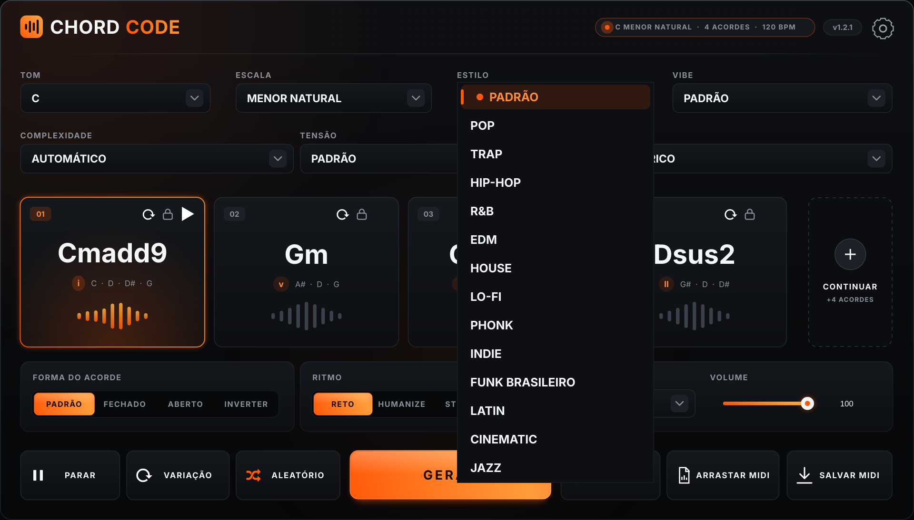
*`img/dropdown.png`: lista aberta; item atual destacado em laranja translúcido.*

### 3.4 Os cards de acorde (o coração visual)
Quatro cards lado a lado (até oito com Continuar). Cada card mostra:
- **Número** da posição em etiqueta pequena (01, 02, 03, 04); laranja no card selecionado.
- **Ícones** no canto superior direito: ↻ variação (troca só este acorde), 🔒 trava, ▶ tocar (aparece no card selecionado/tocando).
- **Nome do acorde** enorme, branco, Bold (Cmadd9, Gm, G#add9, Dsus2…).
- **Grau** em pílula laranja (i, v, VI, II; minúsculo = menor, maiúsculo = maior) seguido das **notas** separadas por pontos ("C · D · D# · G").
- **Mini waveform**: 9 barras verticais arredondadas, simétricas, mais altas no centro. Em repouso são cinza (`#3B414A`).

**Estados do card**
| Estado | Visual |
|---|---|
| Repouso | Grafite, borda cinza fina, barras cinza |
| Hover | Fundo um pouco mais claro, borda mais forte, sobe 3 px |
| Selecionado | Borda laranja, glow laranja leve (35%) |
| **Tocando** | Borda laranja forte com glow, **luz laranja subindo do pé do card**, barras viram gradiente âmbar → laranja e **pulsam com o som** |
| Travado | Cadeado fechado laranja |

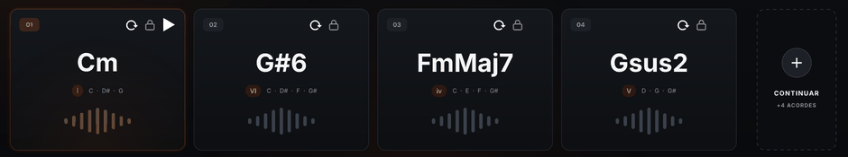
*`img/cards-animacao.gif`: o destaque passando de card em card durante a reprodução. Ótima referência de movimento.*

**Card "Continuar"** (5º espaço): borda tracejada, círculo com "+", texto "CONTINUAR / +4 ACORDES". Leva a progressão de 4 para 8 acordes mantendo os 4 primeiros.

### 3.5 Painel de forma e ritmo
Três grupos em caixas mais escuras:
- **FORMA DO ACORDE** (segmentado): PADRÃO · FECHADO · ABERTO · INVERTER
- **RITMO** (segmentado): RETO · HUMANIZE · STRUM · ARPEJO
- **DURAÇÃO** (dropdown 1/4, 2/4, 4/4) e **VOLUME** (slider laranja com bolinha branca de borda laranja, valor 0–100)

O segmento ativo é uma pílula **laranja sólida** com texto escuro; os outros são texto cinza.

### 3.6 Barra de ações (rodapé)
`PARAR/REPRODUZIR` · `VARIAÇÃO` · `ALEATÓRIO` · **`GERAR`** · `HISTÓRICO` · `ARRASTAR MIDI` · `SALVAR MIDI`

- **GERAR** é o maior elemento da tela: botão largo com **gradiente laranja → âmbar**, texto escuro espaçado ("G E R A R") e **glow laranja** forte ao redor. É o herói de qualquer cena.
- Os demais são botões grafite com ícone de linha à esquerda e rótulo em caixa alta. O ícone de ALEATÓRIO (setas cruzadas) é laranja.

---

## 4. Telas secundárias (modais)

Todos os modais abrem sobre a interface **desfocada e escurecida**, num cartão grafite com leve gradiente quente no topo, raio grande e ícone laranja à esquerda do título.

### 4.1 Seletor de acordes ("Trocar acorde")
Clique num card → abre o seletor com duas abas.

**Campo harmônico**: os acordes da escala agrupados por função (pílula com o grau em laranja + nome: MEDIANTE, SUBDOMINANTE, DOMINANTE, SUBTÔNICA…). O acorde atual fica com **borda laranja**. Rodapé: "Passe o mouse para ouvir · clique para trocar".

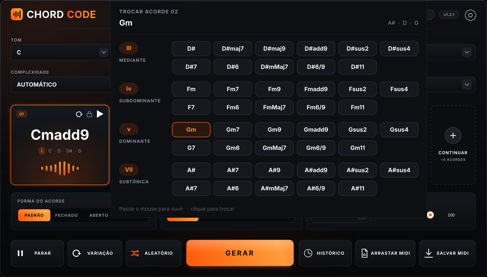

**Todos os acordes**: grade de 12 fundamentais × 15 qualidades (maior, m, 7, maj7, m7, dim, m7b5, dim7, aug, sus2, sus4, add9, 9, maj9, m9), inclusive fora do tom. Na landing: "180 acordes para escolher".

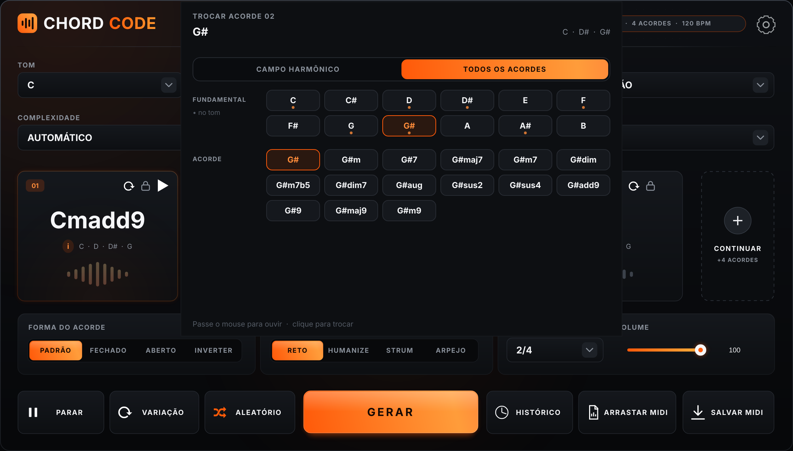

### 4.2 Configurações
Título "CONFIGURAÇÕES / Chord Code" + pílula de versão laranja. Seções: **TEMPO** (Sincronizar BPM com toggle laranja, "projeto: 120 BPM", grade de BPMs 80–160), **LICENÇA** ("● Licenciado" em verde, Trocar), **ATUALIZAÇÕES** (Verificar atualizações), crédito do piano.

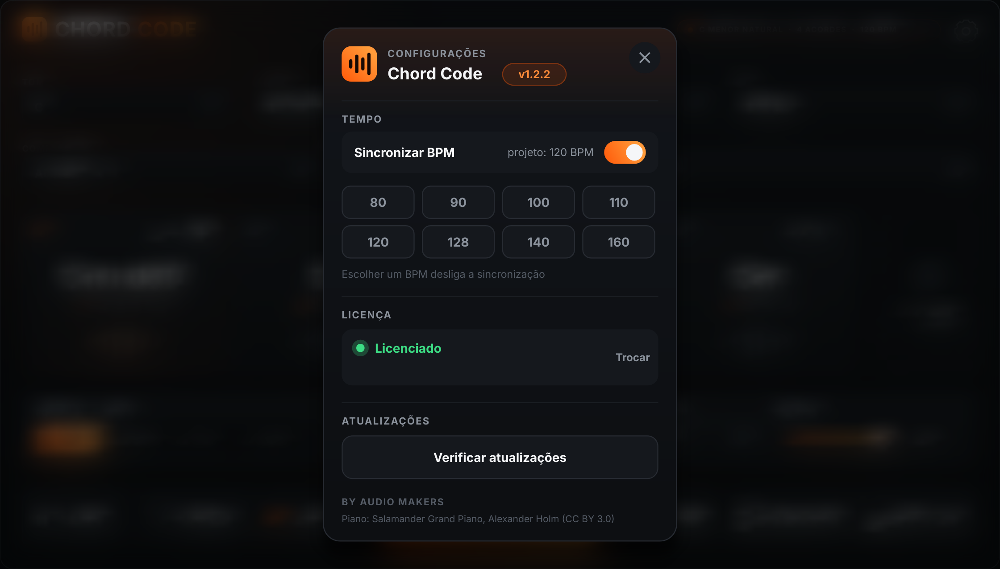

### 4.3 Ativação por e-mail
"LICENÇA / Ative o Chord Code": campo "E-MAIL DA COMPRA" e botão laranja **Ativar**. Na imagem, estado de erro em vermelho.

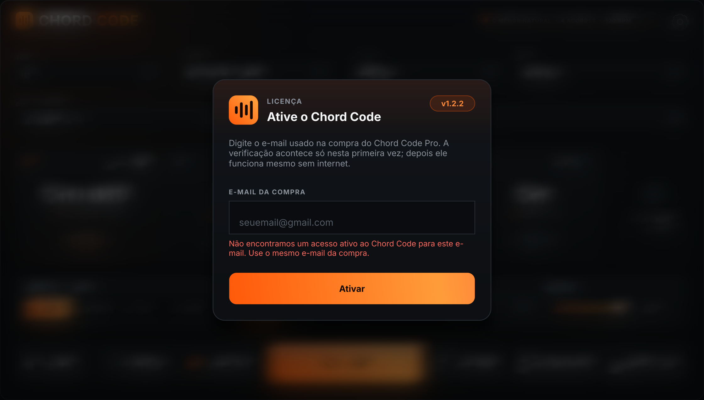

### 4.4 Nova versão disponível
Ícone de download laranja, "v1.2.2 → v1.2.3" em pílulas, notas da versão, botões "Agora não" e **Baixar atualização**.

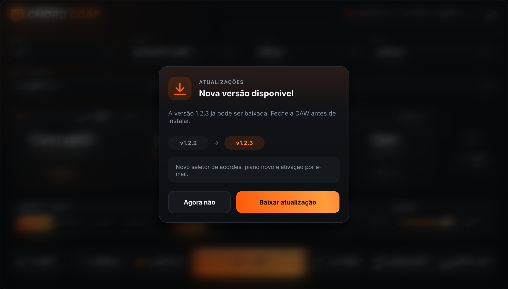

### 4.5 Instalador (Windows)
Janelas pequenas (640×500) no mesmo tema escuro: opções → progresso → concluído.

| Opções | Progresso | Concluído |
|---|---|---|
| 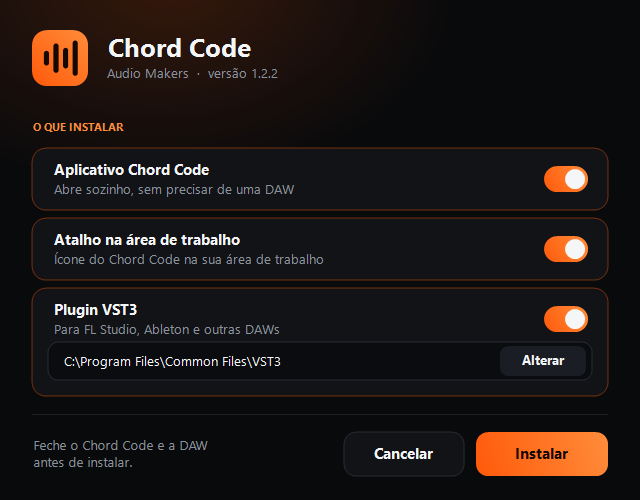 | 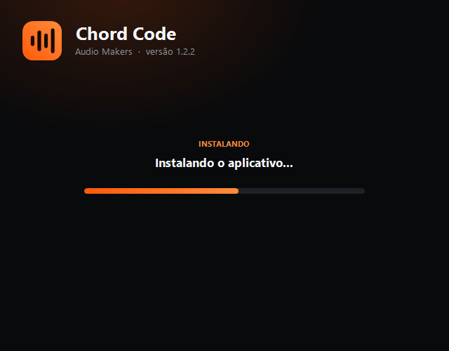 | 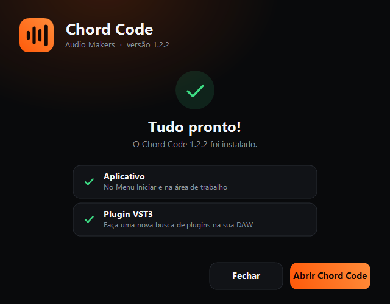 |

---

## 5. Movimento e microinterações

Como o plugin se mexe (tirado do código); use como referência de animação no vídeo:

- **Easing suave**, sem "bounce": hover aproxima o alvo a ~30% por frame, ativação a ~22% (curva exponencial de saída, tipo ease-out).
- **Hover**: o card sobe 3 px, clareia levemente e a borda fica mais visível.
- **Tocando**: o glow laranja acende ao redor do card, uma luz quente sobe da base e as 9 barras viram gradiente âmbar/laranja, **pulsando** com a reprodução. Ao passar para o próximo acorde, o destaque "caminha" de card em card (ver o GIF).
- **GERAR**: sempre com glow; no clique, os nomes dos acordes trocam (ótimo momento para corte/whoosh).
- **Bolinha de atualização**: pulsa em amarelo `#FFD23A`.
- **Modais**: fundo desfoca e escurece; o cartão aparece por cima.
- **Arrastar MIDI**: o usuário arrasta a partir do botão e solta o arquivo `.mid` na DAW (piano roll).

---

## 6. Peças de marketing e moldes

### 6.1 Caixa 3D (packshot)
Caixa escura com lateral laranja vertical escrita "CHORD CODE", frente com logo, "Progressões de acordes prontas para sua DAW", screenshot da interface, pílulas VST3 · AU · Win·Mac e "AUDIO MAKERS". Fundo preto com brilho laranja.

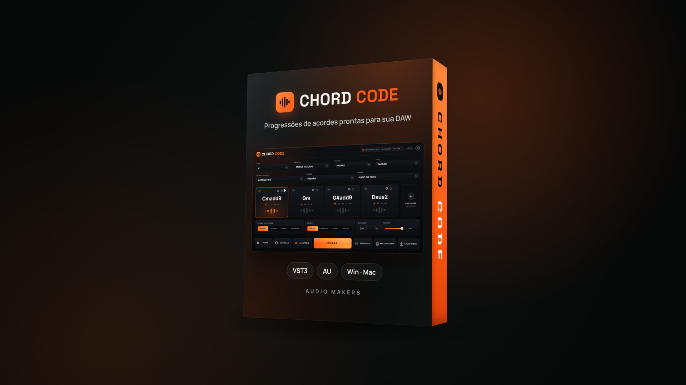

Sem fundo, para compor: [`img/chordcode-box-3d-transparente.png`](img/chordcode-box-3d-transparente.png). Interface em tablet inclinado com borda luminosa, sem fundo: [`img/chord-code-cutout.webp`](img/chord-code-cutout.webp).

### 6.2 Landing page (v31)
Hero com tags de formato, "FEITO PARA QUEM PRODUZ", título "Você traz a ideia. **O CHORD CODE encontra os acordes.**" e a interface num tablet inclinado com borda luminosa laranja.

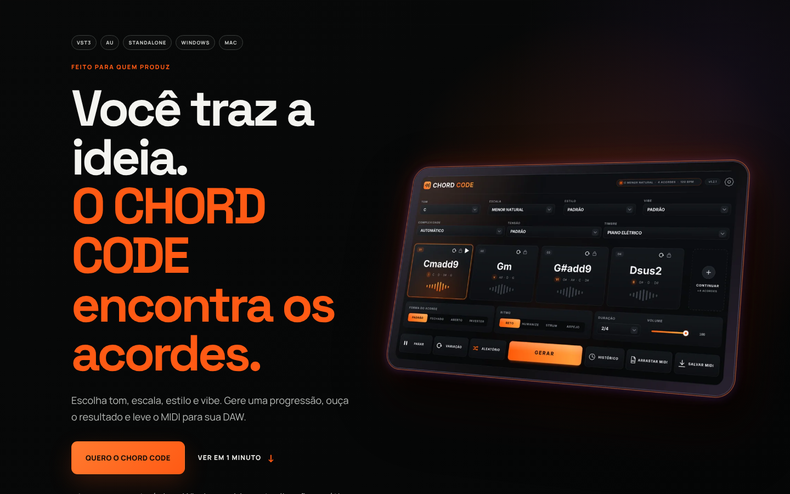
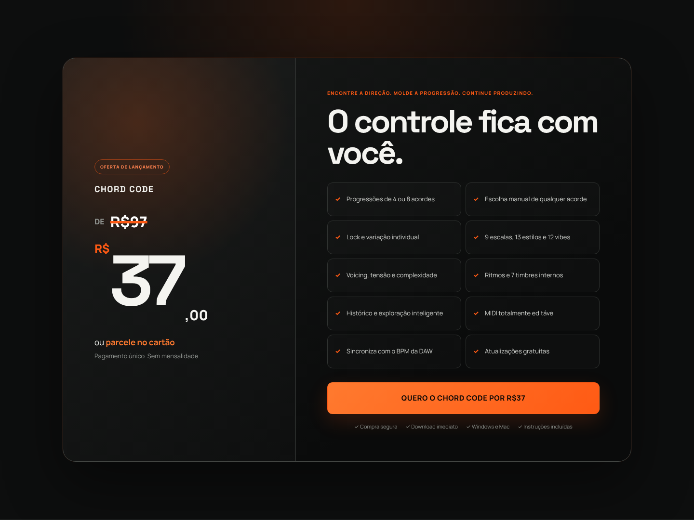

### 6.3 Story 1080×1920, molde atual (20/11/2026)
É o molde que o Ed aprovou no Mini Knobz, aplicado ao Chord Code. Use este para novos stories.

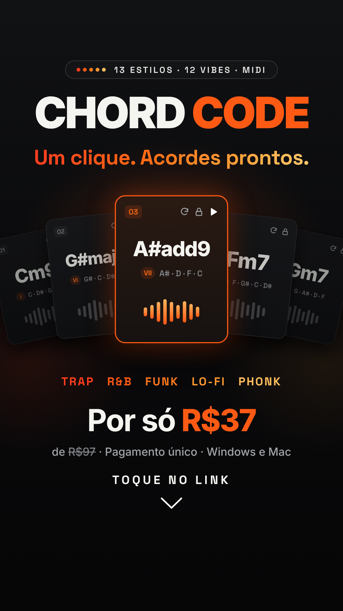

Estrutura, de cima para baixo (tudo centralizado):
1. ~190 px livres no topo (barra do Instagram).
2. **Pílula** com 5 pontinhos em degradê laranja→âmbar + "13 ESTILOS · 12 VIBES · MIDI" (Space Grotesk 600, tracking largo, borda `#34363A`).
3. **CHORD CODE** gigante (Inter 900, ~136 px, tracking negativo), CODE em `#FF5A14`.
4. **Subtítulo de duas batidas** em gradiente `#FF3D1F → #FF6A14 → #FFA23A → #FFC76B`: "Um clique. Acordes prontos."
5. **Leque de 5 cards de acorde** inclinados (±6° e ±12°), o do meio maior, aceso (borda laranja + glow + barras em gradiente) com ▶; os laterais escurecidos.
6. **Linha de estilos** em tons de laranja: TRAP · R&B · FUNK · LO-FI · PHONK.
7. **Preço**: "Por só **R$37**" (Inter 700, ~96 px) e "de ~~R$97~~ · Pagamento único · Windows e Mac".
8. **TOQUE NO LINK** + seta, terminando por volta de 1600 px. Os ~320 px de baixo ficam vazios (campo de resposta do Instagram).

Fundo: gradiente vertical `#111214 → #060607` com brilho radial laranja (20%) atrás dos cards. Fonte editável: [`fonte/story-chord-code-r37.html`](fonte/story-chord-code-r37.html), render com `node fonte/render.cjs <html> <png>` (Playwright).

### 6.4 Anúncios de outubro (feed e story)
| Conceito | Visual |
|---|---|
| **Você traz a ideia** | Título branco + laranja alinhado à esquerda, 3 cards de acorde flutuando, caixa 3D, pílulas de números, botão laranja "QUERO O CHORD CODE →" |
| **Travou na harmonia** | Gancho de dor |
| **Claro notebook** | Única peça em fundo claro (off-white quente), "Crie progressões **em segundos**", interface num notebook |

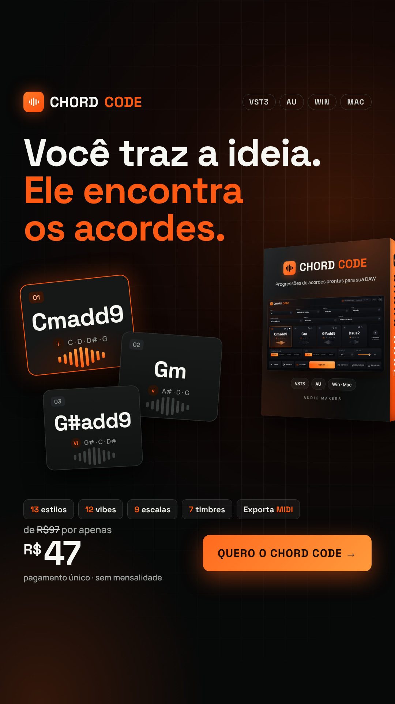
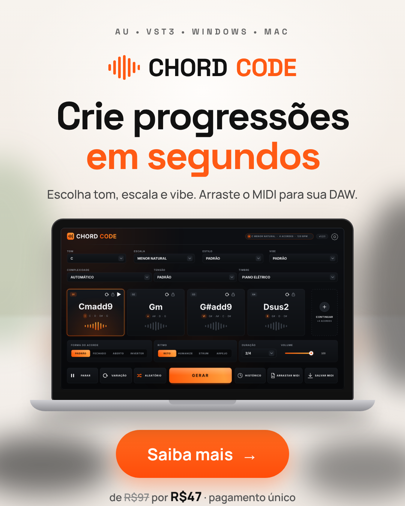

Esses mostram R$47; ao reaproveitar, troque para R$37.

### 6.5 Vídeo
Títulos curtos centralizados no topo, parte branca e parte laranja; números gigantes ("12", "13 ESTILOS"); o destaque laranja caminhando pelos cards; card final com ícone, "Chord Code **Pro**", pílulas de recursos e botão laranja.

---

## 7. Textos e frases prontas

**Títulos / ganchos**
- Você traz a ideia. **O Chord Code encontra os acordes.**
- Pare de travar nos acordes.
- Crie progressões **em segundos**.
- Da ideia ao MIDI.
- 1 clique. **4 acordes.**
- Gostou? **Trava.**
- Quer mais **cor?**
- Qualquer acorde. **Até fora do tom.**
- Menos tentativa. **Mais música.**
- Gerar não significa perder o controle.
- O plugin dá a direção. A decisão continua sendo sua.
- Ele encontra a direção. Você continua no controle.
- Cada GERAR traz algo novo.
- A progressão não termina no Chord Code.
- Tudo à vista. Nada escondido em menu.
- Pensa como um produtor do gênero.
- Não soa como bloco de MIDI.

**Verbos do fluxo** (sequência da landing): **GERE** uma base. **ESCOLHA** um acorde específico. **TRAVE** o que funcionou. **VARIE** somente o que quiser. **CONTINUE** na sua DAW.

**CTAs**: QUERO O CHORD CODE · QUERO O CHORD CODE POR R$37 · GARANTA O SEU AGORA · QUERO LEVAR PARA MINHA DAW · Saiba mais →

**Selos de confiança**: Compra segura · Download imediato · Windows e Mac · Pagamento único, sem mensalidade · Atualizações grátis

**Links**: Pro `chordcodepro.audiomakers.club` · Mini `chordcode.audiomakers.club`
